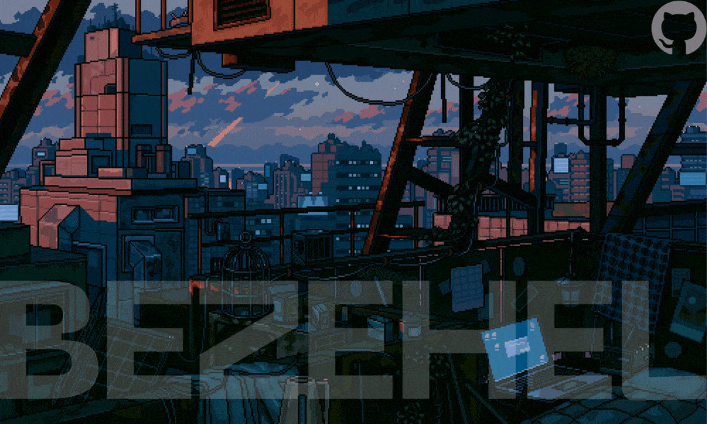

<!-- MasterHead -->

<!-- Greeting -->
<!--<h2 align="center">❂ I am Pranav Dubey</h2>-->

  <!-- Profile Views -->
  
  

  <!-- Total Stars -->
  

  <!-- Followers -->
  

  
  

<!-- About Me -->
<h3 align="left">💫 About Me</h3>

  👋 I'm <b>Pranav Dubey</b>, a B.Tech CSE student at VIT Bhopal (2023 – 2027). 
  🌱 Currently working as an <b>AI Engineering Intern</b> at AthlezTech Innovations, training YOLOv8 object detectors on cricket match footage. 
  🔭 I build GenAI and ML systems: agentic RAG pipelines, LLM agents and deep learning models served with FastAPI. 
  💬 Skills: Python, PyTorch, TensorFlow, LangChain, LangGraph, RAG, FastAPI, Docker, AWS. 
  ⚡ Interested in LLMs, Computer Vision, AI Agents and taking ML models to production. 

<h3 align="left">🧲 Drop me a line:</h3>

  
  
  

 
 

<!-- Languages & Tools -->
<h3 align="center">📚 Languages & Tools I Have Placed My Hands On</h3>

   
   
   

 

<!-- Best Repositories -->

  <h3>⭐️ Interesting Repositories</h3>
  

    

  

<!-- Tech Stack -->
<h3 align="center">💻 Tech Stack</h3>

<!-- Languages -->

<!-- GenAI & LLMs -->

<!-- Machine Learning -->

<!-- Data -->

<!-- Backend & APIs -->

<!-- DevOps & Tools -->

<!-- See more of me -->
<h3 align="center">See More of Me</h3>

  

<!-- Ending -->

